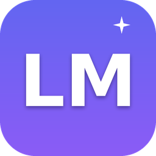

<div align="center">



# LiteMind Engine

**Local AI coding chat for low-end Windows PCs — no cloud, no subscription, no AVX required.**

[](https://github.com/aleksejsum113-lab/litemind-engine/releases/latest)
[](LICENSE)

**[⬇️ Download LiteMind Engine for Windows x64](https://github.com/aleksejsum113-lab/litemind-engine/releases/latest)**

[Русский](README.md) | English

</div>

---

## What is LiteMind Engine

LiteMind Engine is a Windows desktop application that turns an ordinary office
PC or an old laptop into a local AI workstation. In a single window you get an
AI chat with local LLMs, a catalog of curated coding models, a download manager,
hardware analysis and resource monitoring.

The neural network runs **entirely on your computer**: dialogs, code and files
never leave your machine. The internet is needed once — to download a model.
There is no subscription, quota or token budget: the model answers as long as
you need.

The key feature is the **Adaptive Engine**: the engine analyzes your hardware
(including weak CPUs without AVX/AVX2, e.g. Intel Celeron N5095A), picks safe
model settings, monitors memory and prevents generation from freezing Windows.

## What's new in v0.4.0

- **Built-in llama.cpp runtime** — the engine finds and launches `llama-server`
  on its own (a no-AVX build shipped inside the installer). Ollama is no longer
  required: GGUF files are read directly, no intermediate model installs.
- **Modern AI chat** — a full-screen conversation in the spirit of contemporary
  AI apps (LiteMind's own design): chat history and "New chat", Markdown with
  code highlighting, model picker next to the input box, file attachments
  (PDF, DOCX, text, code — real content is sent to the model), streaming
  answers with a Stop button.
- **Model manager** — scans the models folder and shows size, format and
  quantization from the GGUF header, rates RAM compatibility honestly, and
  actually deletes model files to free disk space.
- **Own Windows identity** — dedicated app id (`ai.litemind.desktop`), the
  `litemind://` protocol and a separate entry in "Apps & Features": no
  conflicts with OpenCode or other applications.

## What it solves

- **Writing and explaining code** — the catalog is focused on coding models
  (Qwen2.5 Coder, DeepSeek Coder, StarCoder2, Granite Code); the chat sees the
  project context and files.
- **Working with texts** — explain, translate, summarize and edit documents
  without uploading them anywhere.
- **Privacy** — everything stays on your disk: suitable for confidential
  projects and air-gapped networks.
- **Offline use** — once the model is downloaded, no internet is needed.
- **Getting started with local AI** — the catalog shows which model physically
  fits into your memory and marks compatible options.

## How it differs from LM Studio, Jan and Ollama

| | **LiteMind Engine** | LM Studio | Jan | Ollama |
| --- | --- | --- | --- | --- |
| License | MIT, open source | proprietary | MIT, open source | MIT, open source |
| Interface | Full desktop app: chat + catalog + downloads + monitoring in one window | proprietary GUI | GUI | CLI + local server; GUI only via third-party shells |
| Weak PCs without AVX/AVX2 | **Target platform**: hardware auto-analysis, safe limits, freeze protection | not a target platform, AVX2 recommended | works, no low-end adaptation | works, thread/context tuning is manual |
| Model auto-optimization | Yes: tokens/sec & TTFT measurement, thread tuning, best profile saved | partial (manual quantization pick) | no | no |
| Windows memory protection | Memory gate, watchdog, auto-unload under pressure, process priority | no | no | no |
| Curated GGUF model catalog | Built-in, with hardware compatibility rating | yes | yes | CLI registry |
| Chat with project context | yes (project files + terminal in one window) | yes | yes | no (CLI only) |
| Open API | OpenAI-compatible on `127.0.0.1:8399` | yes | yes | yes (`11434`) |

In short: Ollama is a backend without a UI, LM Studio is polished but closed and
heavy, Jan is an open general-purpose GUI. LiteMind focuses on one scenario —
**a coding assistant on a weak Windows PC** — with automatic tuning nobody else
does.

## System requirements

| Component | Minimum | Recommended |
| --- | --- | --- |
| OS | Windows 10 x64 (1903+) | Windows 11 x64 |
| CPU | 2 cores, x64 | 4 cores; **AVX/AVX2 not required** |
| RAM | 8 GB (0.5B–1.5B models) | 16 GB (3B–7B models) |
| Disk | 2 GB for the app | + 1–6 GB per model (disk is selectable) |
| GPU | Not required | Any — the engine works without one |
| Backend | [Ollama](https://ollama.com) for Windows | Installed beforehand; detected automatically |

Verified on Intel Celeron N5095A (4 cores, no AVX/AVX2) + 16 GB RAM — the
target configuration of this project.

## Supported models

The built-in catalog v2 ships **42 verified models (143 GGUF files)** from
trusted Hugging Face sources: official vendor repos (HuggingFaceTB,
Vikhrmodels, microsoft, unsloth) and quants by reputable authors (bartowski,
mradermacher, QuantFactory, TheBloke). Every file stores its exact size and
the **SHA-256 from Hugging Face** — the "Verify file" button compares the
download byte-by-byte.

Families: Qwen2.5 / Qwen3 / Qwen3.5, Qwen2.5 Coder, DeepSeek Coder and
DeepSeek R1 Distill, Microsoft Phi-3.5/Phi-4-mini, Google Gemma 2/3, Meta
Llama 3.2, Mistral 7B and Ministral 8B, SmolLM2/SmolLM3, TinyLlama, Russian
Vikhr and Saiga2, plus the uncensored Dolphin and Huihui (abliterated) lines.

**Restriction categories are explicitly separated** ("standard" vs
"reduced/uncensored"). Reduced refusals do not mean "no limits at all":
behavior depends on the specific model and its training.

**Compatibility is computed automatically** for your hardware (weights +
KV-cache for the context + buffers + Windows reserve), with five statuses:
"Great fit", "OK with limitations", "Will be slow", "Not recommended",
"Incompatible". Filters cover purpose (chat / coding / Russian / reasoning),
restrictions, compatibility, size (up to 1B / 1–4B / 5B+) and quantization
(Q2_K … Q8_0). Each card offers Download / Verify file / Run / Open in AI
Chat / Stop / Delete.

Drop any GGUF into the models folder — the built-in llama.cpp runtime picks
it up automatically. Ollama is not required.

## Adaptive Engine

- **Task complexity classification** (simple / file / project / hard) —
  heuristic, no second model needed.
- **Smart context management**: system prompt and first user task stay intact
  (stable prefix → llama.cpp prompt-cache works), middle history is compacted
  into a summary, recent messages are kept.
- **Long inputs** are digested with a fact-preserving extractive summarizer.
- **Safe RAM management**: memory gate before launch, OS reserve, in-generation
  watchdog — dangerous load stops generation and safely unloads the model.
- **CPU thread tuning**: auto-optimization probes configurations, measures
  tokens/sec and TTFT and stores the best profile per model.
- **Performance profiles**: Careful (BelowNormal Ollama priority) /
  **Balanced (default)** / Performance.
- **Honesty**: speculative decoding, prompt lookup and KV-cache quantization
  are not faked — the Ollama API does not support them, and the engine says so
  in its capability map. No silent quality degradation, no silent model swaps.

Details: [docs/litemind/ADAPTIVE-ENGINE.md](docs/litemind/ADAPTIVE-ENGINE.md).

## Installation (Windows x64)

1. Open [**Releases**](https://github.com/aleksejsum113-lab/litemind-engine/releases/latest)
   and download `litemind-desktop-win-x64.exe` (NSIS installer).
2. Windows SmartScreen may warn about an unsigned file: click **"More info" →
   "Run anyway"** (the app ships without paid code signing; sources are open).
3. Install — you can choose the folder; a "LiteMind Engine" shortcut appears on
   the desktop and in the Start menu.
4. Make sure [Ollama](https://ollama.com) is installed — an existing
   installation and downloaded models are not touched.
5. Launch the app with a double click — the engine starts automatically, no
   terminal needed.

A portable build (single exe, no installation) is not shipped yet: an
upstream build-tool patch is incompatible with the NSIS portable target (see
the comment in `packages/desktop/electron-builder.config.ts`). For a
no-install setup, run the installer with the `/S` switch.

## First launch: your first answer in 4 steps

1. **Hardware.** The app opens with the hardware analysis: CPU, RAM, AVX/AVX2,
   GPU, disks — plus a recommended performance profile.
2. **Models folder.** In "LiteMind Settings" pick the disk for models
   (default `E:\LiteMind\models`, any folder works).
3. **Download a model.** In the model catalog pick a green (fully compatible)
   model and click Download — progress, speed and ETA are shown in Downloads.
   Then click Install — the model appears in Ollama.
4. **Ask.** Return to the chat, select the model in the switcher above the
   input box and type your question. Answers are generated locally;
   Monitoring shows tokens/sec and time-to-first-token (TTFT).

## Using the app

All sections live in one window, in the left sidebar: **AI chat** (history,
model switcher, files, project context), **Projects / Workspace** (open a
folder, let the chat read and edit code, built-in terminal), **My models**
(auto-optimization, unload), **Model catalog**, **Downloads** (pause / resume /
cancel, HTTP Range resume, disk choice), **Hardware**, **Monitoring**, and
**LiteMind Settings**.

## Local OpenAI-compatible API

The engine runs inside the desktop app on `127.0.0.1:8399` and serves
`/v1/models` and `/v1/chat/completions` (streaming SSE + usage + timings), so
LiteMind models are available to any OpenAI-compatible client. Loopback only;
LAN access requires explicit `allowLan` + token.

## FAQ / Troubleshooting

**SmartScreen or antivirus blocks the app.** It is not code-signed yet. Click
"More info → Run anyway". Builds are produced automatically from the open
sources of this repository.

**"Engine did not start" / chat is silent.** Check that Ollama is installed and
running (`ollama --version`) and that port `8399` is free. The desktop app
starts the engine automatically.

**Answers are very slow.** Pick a smaller model (1.5B instead of 7B), switch to
the "Careful" profile and run "Auto-optimization" in My models — it tunes CPU
threads for your machine.

**The app eats all memory.** The Adaptive Engine watches RAM and stops
generation under dangerous load. If this happens often, use a smaller model or
close heavy programs.

**Where are models stored?** In the folder from LiteMind Settings (default
`E:\LiteMind\models`). Uninstalling LiteMind Engine does **not** delete this
folder or Ollama models.

**Why no speculative decoding / KV-cache Q8?** Since v0.4 the engine talks to
its own llama.cpp runtime directly; these accelerations are being rolled in
gradually, and until a speedup is actually enabled the capabilities map
(`/api/capabilities`) reports it honestly instead of faking it.

**Can I add my own model?** Yes — drop any GGUF file into the models folder:
it appears in "My models" and in the chat model switcher. Format, quantization
and RAM compatibility are detected automatically from the GGUF header.

**How do I delete a model and free space?** Click "Delete" in "My models" —
LiteMind shows the size and quantization and, after confirmation, really
deletes the GGUF file from disk.

**Where are chats and settings stored?** In the Windows user profile
(`%APPDATA%`); back it up before uninstalling.

## Building from source

```bash
bun install
bun run --cwd packages/app build
bun run --cwd packages/cli build
OPENCODE_CHANNEL=prod bun run --cwd packages/desktop build
bun run --cwd packages/desktop pack --win --x64   # NSIS installer → dist/
```

Engine tests: `cd packages/litemind-engine && npm test` (112 tests).
More: [docs/litemind/BUILD-WINDOWS.md](docs/litemind/BUILD-WINDOWS.md).

## Author & ownership

- **Creator and owner** — GitHub account
  [**aleksejsum113-lab**](https://github.com/aleksejsum113-lab): author of the
  idea, requirements and architecture of LiteMind Engine, owner of the
  repository and publications.
- Versions v0.3–v0.4 were developed **with the assistance of AI agents**
  (code and test generation to the author's specifications); task definition,
  all architectural decisions, acceptance and release remain with the project
  author.
- LiteMind Engine is **not affiliated** with OpenAI, OpenCode, LM Studio or any
  other model/tool vendors.
- Historical basis: the project grew out of a fork of **OpenCode V2** (MIT);
  inherited components keep their upstream authorship and license.

## License

The project code is distributed under the **MIT** license:

- new development and changes of LiteMind Engine (v0.1–v0.4) — © 2026
  [aleksejsum113-lab](https://github.com/aleksejsum113-lab);
- components inherited from OpenCode V2 — MIT, © their authors (the
  [LICENSE](LICENSE) file is kept unchanged and remains in effect).

Catalog models are distributed under their authors' licenses (see each model
card in the catalog).
