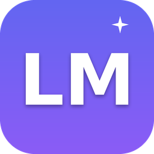

<div align="center">



# LiteMind Engine

**Локальный ИИ-чат с нейросетями-«кодерами» для слабых Windows-ПК — без облака,
без подписок и без требования AVX.**

[](https://github.com/aleksejsum113-lab/litemind-engine/releases/latest)
[](LICENSE)
[](#сборка-из-исходников)

**[⬇️ Скачать LiteMind Engine для Windows x64](https://github.com/aleksejsum113-lab/litemind-engine/releases/latest)**

Установщик `litemind-desktop-win-x64.exe` (NSIS), размеры файла и
SHA-256 контрольные суммы — в разделе **[Releases](https://github.com/aleksejsum113-lab/litemind-engine/releases)**.
Ссылка всегда ведёт на актуальный стабильный релиз.

Русский | [English](README.en.md)

</div>

---

## Что такое LiteMind Engine

LiteMind Engine — это настольное приложение для Windows, которое превращает
обычный офисный компьютер или старый ноутбук в рабочую станцию с локальным
искусственным интеллектом. Внутри одного окна вы получаете AI-чат с локальными
нейросетями, каталог проверенных моделей для программирования, менеджер загрузок,
анализ железа и мониторинг ресурсов.

Нейросеть работает **прямо на вашем компьютере**: диалоги, код и файлы никуда
не отправляются. Интернет нужен один раз — чтобы скачать модель. Никакой
подписки, квот или «токенов на месяц» не существует: модель отвечает столько,
сколько нужно.

Главная особенность — **Adaptive Engine**: движок сам анализирует ваше железо
(в том числе слабые CPU без инструкций AVX/AVX2, например Intel Celeron
N5095A), подбирает безопасные настройки моделей, следит за памятью и не даёт
генерации «зависнуть» Windows.

## Новое в v0.4.0

- **Собственный runtime llama.cpp** — движок сам находит и запускает
  `llama-server` (сборка без AVX/AVX2, входит в установщик). Ollama больше не
  нужна: никакой промежуточной установки моделей, GGUF-файл читается напрямую.
- **AI-чат нового поколения** — полноэкранный диалог в духе современных
  ИИ-приложений (собственный дизайн LiteMind): история чатов и «Новый чат»,
  Markdown с подсветкой кода, выбор модели прямо у строки ввода, вложения
  (PDF, DOCX, тексты, код — содержимое реально уходит в модель), стриминг
  ответа с кнопкой «Остановить».
- **Менеджер моделей** — сканирование папки моделей с показом размера, формата
  и квантования из заголовка GGUF, честная оценка совместимости с вашей RAM и
  настоящее удаление файлов модели с освобождением места.
- **Отдельная идентичность в Windows** — собственный app id
  (`ai.litemind.desktop`), протокол `litemind://`, отдельная запись в
  «Установке и удалении программ»: конфликтов с OpenCode и другими приложениями нет.

## Какие задачи решает

- **Написание и разбор кода** — каталог заточен под coding-модели Qwen2.5 Coder,
  DeepSeek Coder, StarCoder2 и Granite Code; чат видит контекст проекта и файлы.
- **Работа с текстами** — объяснение, перевод, суммаризация и редактирование
  документов без их загрузки в облако.
- **Приватность** — всё остаётся на диске вашего компьютера: подходит для
  конфиденциальных проектов и закрытых сетей.
- **Офлайн-работа** — после скачивания модели интернет больше не нужен.
- **Освоение локального ИИ** — каталог подсказывает, какая модель физически
  поместится в вашу память, а приложение само предложит совместимые варианты.

## Чем отличается от LM Studio, Jan и Ollama

| | **LiteMind Engine** | LM Studio | Jan | Ollama |
| --- | --- | --- | --- | --- |
| Лицензия | MIT, открытый код | проприетарная | MIT, открытый код | MIT, открытый код |
| Интерфейс | Полноценное desktop-приложение: чат + каталог + загрузки + мониторинг в одном окне | Проприетарный GUI | GUI | CLI + локальный сервер, GUI только у сторонних оболочек |
| Слабые ПК без AVX/AVX2 | **Целевая платформа**: автоанализ железа, безопасные лимиты, защита от зависаний | Не целевая платформа, рекомендуются AVX2 | Работает, но без адаптации к слабому железу | Работает, настройки потоков/контекста вручную |
| Автооптимизация моделей | Есть: замер tokens/sec и TTFT, подбор потоков, сохранение лучшего профиля | Частично (подбор квантования вручную) | Нет | Нет |
| Защита памяти Windows | Memory-gate, watchdog, авто-выгрузка при перегрузке, приоритет процессов | Нет | Нет | Нет |
| Каталог проверенных GGUF-моделей | Встроен, с оценкой совместимости с вашим железом | Есть | Есть | Реестр из CLI |
| Chat с контекстом проекта | Да (файлы проекта + терминал в одном окне) | Да | Да | Нет (через CLI) |
| Открытый API | OpenAI-совместимый на `127.0.0.1:8399` | Да | Да | Да (`11434`) |

Коротко: Ollama — это движок-бэкенд без интерфейса, LM Studio — удобный, но
закрытый и тяжёлый продукт, Jan — открытый GUI общего назначения. LiteMind
специализируется на одном сценарии — **coding-помощник на слабом Windows-ПК** —
и делает это с автоматической настройкой, которой нет у других.

## Системные требования

| Компонент | Минимум | Рекомендуется |
| --- | --- | --- |
| ОС | Windows 10 x64 (1903+) | Windows 11 x64 |
| CPU | 2 ядра, x64 | 4 ядра; **AVX/AVX2 не требуются** |
| RAM | 8 ГБ (модели 0.5B–1.5B) | 16 ГБ (модели 3B–7B) |
| Диск | 2 ГБ для приложения | + 1–6 ГБ на каждую модель (диск можно выбрать) |
| GPU | Не требуется | Любой — движок работает и без него |
| Runtime | **В комплекте** (llama.cpp, сборка без AVX) | Ничего устанавливать не нужно |

Проверено на Intel Celeron N5095A (4 ядра, без AVX/AVX2) + 16 ГБ RAM — это
целевая конфигурация проекта.

## Поддерживаемые модели

Встроенный каталог v2 содержит **42 проверенные модели (143 GGUF-файла)** от
проверенных источников Hugging Face: официальные репозитории производителей
(HuggingFaceTB, Vikhrmodels, microsoft, unsloth) и квантования признанных
авторов (bartowski, mradermacher, QuantFactory, TheBloke). Для каждого файла
каталог хранит точный размер и **SHA-256 из Hugging Face** — кнопка
«Проверить файл» сверяет скачанное побайтово.

Семейства: Qwen2.5 / Qwen3 / Qwen3.5, Qwen2.5 Coder, DeepSeek Coder и
DeepSeek R1 Distill, Microsoft Phi-3.5/Phi-4-mini, Google Gemma 2/3, Meta
Llama 3.2, Mistral 7B и Ministral 8B, SmolLM2/SmolLM3, TinyLlama, русские
Vikhr и Saiga2, а также uncensored-линейки Dolphin и Huihui (abliterated).

**Категории ограничений** разделены явно и не смешиваются:

- «Обычные ограничения» — стандартные модели с встроенными правилами
  безопасности разработчика;
- «Ослабленные ограничения» (Uncensored / Abliterated) — модели, обученные
  отвечать с меньшим числом отказов. Отсутствие встроенных отказов не означает
  отсутствия всех ограничений: поведение зависит от конкретной модели и её
  обучения.

**Совместимость считается автоматически** под ваше железо (для целевой
конфигурации — Celeron N5095A, 4 ядра без AVX/AVX2, 16 ГБ RAM, без
дискретной видеокарты): учитываются веса, KV-кэш под контекст, буферы и
резерв Windows. Итоговые статусы: «Отлично подходит», «Подходит с
ограничениями», «Будет работать медленно», «Не рекомендуется»,
«Несовместима» — неподходящие модели не показываются как рекомендуемые.

**Фильтры каталога**: задача (общение / программирование / русский /
логика), ограничения (обычные / ослабленные), совместимость («для моего
ПК», «только отличные»), размер (до 1B / 1–4B / 5B+), квантование
(Q2_K … Q8_0). В карточке модели: размер и рекомендуемый квант, требуемая
память, качество и скорость, языки, лицензия и автор квантования, а кнопки
«Скачать», «Проверить файл», «Запустить», «Открыть в AI Chat», «Остановить»,
«Удалить» закрывают весь цикл без ручной настройки.

Свои GGUF-файлы достаточно положить в папку моделей — собственный runtime
llama.cpp увидит их автоматически (формат, квантование и совместимость с RAM
определяются по заголовку GGUF). Ollama не требуется: с v0.4 LiteMind работает
на собственном runtime, а Ollama остаётся опциональной интеграцией.

## Adaptive Engine

Ключевой компонент LiteMind — адаптивный контроллер, который делает локальный ИИ
реально пригодным для слабых машин:

- **Классификация сложности** каждого запроса (simple / file / project / hard)
  эвристикой, без второй модели и лишней нагрузки.
- **Умное управление контекстом**: системный промпт и первая задача сохраняются
  полностью (стабильный префикс реально работает с prompt-cache llama.cpp),
  середина истории сжимается в сводку, недавние сообщения остаются целиком.
- **Длинные входы** перевариваются extractive-дайджестом с сохранением фактов.
- **Безопасное управление RAM**: проверка памяти до запуска модели, резерв под
  Windows, контроль во время генерации — при опасной нагрузке генерация
  останавливается и модель безопасно выгружается (MEMORY_OVERLOAD).
- **Настройка потоков CPU**: автооптимизация перебирает конфигурации, замеряет
  tokens/sec и TTFT и сохраняет лучший профиль для каждой модели.
- **Профили производительности**: Бережный (низкий приоритет процессов
  llama-server) / **Сбалансированный (по умолчанию)** / Производительный.
- **Честность**: speculative decoding, prompt lookup и квантование KV-cache не
  включаются фиктивно — пока ускорение не активировано в движке, карта
  возможностей (`/api/capabilities`) прямо сообщает об этом. Никаких «немых»
  ухудшений качества и незаметных подмен модели.

Подробнее: [docs/litemind/ADAPTIVE-ENGINE.md](docs/litemind/ADAPTIVE-ENGINE.md).

## Установка (Windows x64)

1. Откройте раздел [**Releases**](https://github.com/aleksejsum113-lab/litemind-engine/releases/latest)
   и скачайте `litemind-desktop-win-x64.exe` (NSIS-установщик).
2. Windows SmartScreen может предупредить о неподписанном файле: нажмите
   **«Подробнее» → «Выполнить в любом случае»** (приложение распространяется
   без платной подписи кода, исходники открыты).
3. Установите: можно выбрать папку; ярлык «LiteMind Engine» появится на рабочем
   столе и в меню «Пуск».
4. Запустите приложение двойным щелчком — runtime llama.cpp уже в комплекте,
   движок поднимется автоматически, терминал и команды не нужны.

Существующая установка OpenCode не затрагивается: с v0.4 у LiteMind собственные
app id (`ai.litemind.desktop`), протокол `litemind://` и отдельная запись в
«Установке и удалении программ».

Portable-версия (один exe без установки) пока не поставляется: патч
   upstream-движка сборки несовместим с portable-таргетом NSIS (см. комментарий
   в `packages/desktop/electron-builder.config.ts`). Для работы без установки
   можно использовать установщик в режиме `/S`.

## Первый запуск: до первого ответа за 4 шага

1. **Железо.** Откроется раздел «Железо» с результатами анализа CPU, RAM,
   AVX/AVX2, GPU и дисков — и рекомендацией профиля производительности.
2. **Папка моделей.** В «Настройках LiteMind» выберите диск для моделей
   (по умолчанию `E:\LiteMind\models`, можно любой другой).
3. **Скачайте модель.** В «Каталоге моделей» выберите зелёную (полностью
   совместимую) модель и нажмите «Скачать» — прогресс, скорость и ETA видны в
   разделе «Загрузки». Готово — модель сразу появится в «Моих моделях» и в
   переключателе чата (отдельная установка не нужна: runtime читает GGUF напрямую).
4. **Спросите.** Вернитесь в чат, выберите модель в переключателе над строкой
   ввода и напишите вопрос. Ответ генерируется локально; в «Мониторинге»
   видны tokens/sec и время первого токена (TTFT).

## Работа в приложении

Все разделы — в одном окне, в левом сайдбаре:

- **AI-чат** — полноэкранный диалог с историей и «Новым чатом»; выбор модели у
  строки ввода; вложения (PDF/DOCX/тексты/код), Markdown и подсветка кода;
  остановка генерации одной кнопкой; контекст проекта.
- **Проекты / Workspace** — откройте папку проекта: чат получает доступ к файлам
  для разбора и правок кода; встроенный терминал позволяет выполнять команды,
  не покидая приложение.
- **Мои модели** — установленные модели, кнопка «Автооптимизация» (подбор
  потоков по скорости), «Выгрузить модель» для освобождения RAM.
- **Каталог моделей** — 42 проверенные модели 12+ семейств, фильтры (задача,
  ограничения, совместимость, размер, квант), кнопки «Скачать / Проверить файл /
  Запустить / Открыть в AI Chat / Остановить / Удалить», проверка SHA-256.
- **Загрузки** — прогресс, скорость, пауза/продолжение/отмена, докачка после
  обрыва связи (HTTP Range), выбор диска.
- **Железо** — CPU, ядра, AVX/AVX2 (три метода определения), RAM, GPU, диски.
- **Мониторинг** — CPU/RAM в реальном времени, tokens/sec и TTFT последней
  генерации, статистика Adaptive Engine, кнопки «Остановить» и «Выгрузить все».
- **Настройки LiteMind** — папка моделей, тумблеры Adaptive Engine, профили.

## Локальный OpenAI-совместимый API

Движок поднимается внутри Desktop-приложения на `127.0.0.1:8399` и отдаёт
`/v1/models` и `/v1/chat/completions` (streaming SSE + usage + timings), поэтому
LiteMind-модели доступны любой программе с OpenAI-совместимым клиентом.
Доступ — только с loopback; LAN включается явно (`allowLan` + токен).

## FAQ и решение проблем

**Установка блокируется SmartScreen / антивирусом.** Приложение пока не имеет
платной цифровой подписи. Нажмите «Подробнее → Выполнить в любом случае».
Проверить себя можно всегда: сборка автоматическая из открытых исходников
этого репозитория.

**«Движок не запустился» / чат не отвечает.** Проверьте, что порт `8399` не
занят другой программой. После запуска Desktop-приложения движок стартует
автоматически, отдельно запускать ничего не нужно. Если в статусе «llama-server
не найден» — переустановите приложение: runtime входит в установщик.

**Ответы идут очень медленно.** Выберите модель поменьше (1.5B вместо 7B),
включите профиль «Бережный» и запустите «Автооптимизацию» в «Моих моделях» —
она подберёт число потоков под ваш CPU.

**Приложение «съедает» всю память.** Adaptive Engine сам следит за RAM:
при опасной нагрузке генерация останавливается, модель выгружается. Если это
происходит часто — работайте с меньшей моделью или закройте тяжёлые программы.

**Куда сохраняются модели?** В папку из «Настроек LiteMind» (по умолчанию
`E:\LiteMind\models`). При удалении LiteMind через Windows деинсталлятор
спросит, удалить ли модели, — по умолчанию они остаются на диске.

**Почему раньше не было speculative decoding и KV-cache Q8?** Раньше LiteMind
работал через Ollama API, который их не отдаёт. С v0.4 движок использует
собственный runtime llama.cpp напрямую — карта возможностей обновляется по мере
внедрения этих ускорений.

**Можно ли добавить свою модель?** Да — положите любой GGUF-файл в папку
моделей: он появится в «Моих моделях» и в переключателе чата. Формат,
квантование и совместимость с RAM определяются автоматически по заголовку GGUF.

**Как удалить модель и освободить место?** В «Моих моделях» нажмите «Удалить» —
LiteMind покажет размер и квантование и после подтверждения действительно
удалит GGUF-файл с диска.

**Где хранятся чаты и настройки?** В профиле пользователя Windows
(`%APPDATA%`); при удалении приложения их можно сохранить вручную.

## Сборка из исходников

```bash
bun install
bun run --cwd packages/app build            # UI
bun run --cwd packages/cli build            # CLI sidecar (нужен для пакета)
OPENCODE_CHANNEL=prod bun run --cwd packages/desktop build   # electron-vite
bun run --cwd packages/desktop pack --win --x64              # NSIS-установщик → dist/
```

Тесты движка: `cd packages/litemind-engine && npm test` (112 тестов).
Подробнее: [docs/litemind/BUILD-WINDOWS.md](docs/litemind/BUILD-WINDOWS.md).

## Структура репозитория

- `packages/litemind-engine` — движок: адаптивный контроллер, каталог, загрузчик,
  собственный runtime llama.cpp (`src/backends/lmlama.js`), парсер GGUF,
  извлечение текста из вложений, анализ железа, API-сервер (Node.js, без зависимостей).
- `packages/app` — интерфейс Desktop (SolidJS), включая нативные экраны LiteMind (`src/litemind`).
- `packages/desktop` — Electron-оболочка, автозапуск движка (`src/main/service/litemind-host.ts`), NSIS-установщик.
- `packages/core` — ядро OpenCode; LiteMind-провайдер подключается плагином (`src/plugin/provider/litemind.ts`).

## Документация

- [docs/litemind/ARCHITECTURE.md](docs/litemind/ARCHITECTURE.md) — архитектура движка
- [docs/litemind/ADAPTIVE-ENGINE.md](docs/litemind/ADAPTIVE-ENGINE.md) — как устроен Adaptive Engine
- [docs/litemind/BUILD-WINDOWS.md](docs/litemind/BUILD-WINDOWS.md) — сборка под Windows
- [CHANGELOG-LITEMIND.md](CHANGELOG-LITEMIND.md) — история версий
- [Releases](https://github.com/aleksejsum113-lab/litemind-engine/releases) — установщик и SHA-256 суммы

## Автор и владелец проекта

- **Создатель и владелец** — GitHub-аккаунт
  [**aleksejsum113-lab**](https://github.com/aleksejsum113-lab): автор идеи,
  требований и архитектуры LiteMind Engine, владелец репозитория и публикаций.
- Разработка версий v0.3–v0.4 велась **при участии ИИ-агентов** (генерация кода
  и тестов по заданиям автора); постановка задач, все архитектурные решения,
  приёмка и публикация — за автором проекта.
- LiteMind Engine **не связан** с OpenAI, OpenCode, LM Studio и другими
  вендорами моделей и инструментов: совпадение технологий (Electron, llama.cpp,
  MIT) не означает аффилиации.
- Историческая основа: проект вырос из форка **OpenCode V2** (MIT).
  Заимствованные компоненты сохраняют авторство и лицензию апстрима —
  см. раздел «Лицензия» ниже.

## Лицензия

Код проекта распространяется по лицензии **MIT**:

- новая разработка и изменения LiteMind Engine (v0.1–v0.4) — © 2026
  [aleksejsum113-lab](https://github.com/aleksejsum113-lab);
- унаследованные от OpenCode V2 компоненты — MIT, © их авторы (файл
  [LICENSE](LICENSE) сохранён без изменений и продолжает действовать).

Модели каталога распространяются по лицензиям своих авторов (см. карточку
каждой модели в каталоге).
